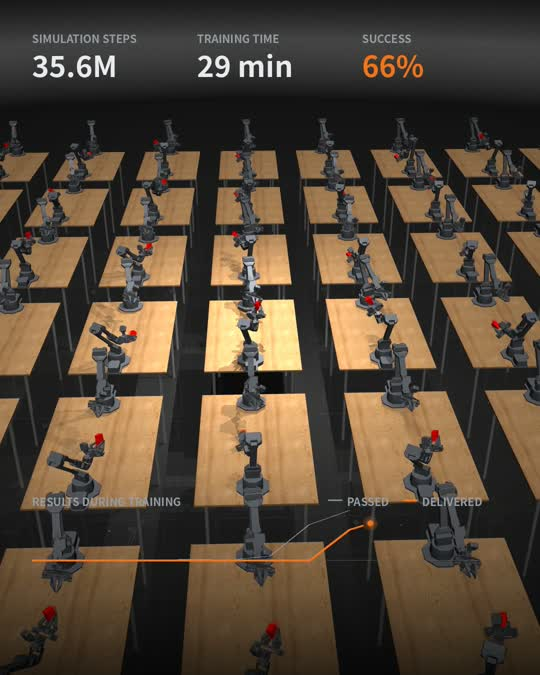
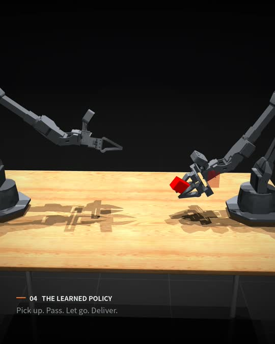

# Bimanual Handover with Reinforcement Learning

Two robot arms learn, from scratch and by trial and error, to pick up a block, hand it from one arm to the other, and deliver it to a target. Training uses PPO on 8,192 simulations running in parallel on a single GPU (MuJoCo MJX + JAX).

<p align="center"> </p>

**Video:** [`video/handover_narrated.mp4`](video/handover_narrated.mp4) (85 s, narrated, 4:5)

## Results

| | |
|---|---|
| Simulation steps | 50.1 M |
| Training time | 41 min on one NVIDIA RTX A4000 |
| Parallel environments | 8,192 |
| Block passed to the other arm | **100 %** of 256 test attempts |
| Block delivered to the target (within 5 cm) | **89 %** of 256 test attempts |

Success per checkpoint: [`results/checkpoint_success.json`](results/checkpoint_success.json). Training curve: [`results/progress.jsonl`](results/progress.jsonl).

## What I learned

My first attempt was my own two-Franka handover environment with a hand-written reward ([`franka_experiments/`](franka_experiments/)). The agent kept finding shortcuts instead of solving the task:

1. It gripped the bar on the floor and never lifted it, because gripping alone already paid.
2. It tipped the bar up by one end to fake a lift.
3. It held the bar perfectly level, still on the floor.

Switching to Cartesian (end-effector) actions made grasping much faster to learn, but lifting stayed stuck. What worked was the reward design from DeepMind's MuJoCo Playground `AlohaHandOver` task: the agent is paid only for **new progress** (a weighted potential that beats its best value so far in the episode), stages are gated by where the object is, and dropping ends the episode. Standing still earns nothing, so the shortcuts disappear.

## Repository

| Folder | Contents |
|---|---|
| `scripts/` | Training (`train_pg.py`), checkpoint evaluation (`rollout_all_pg.py`, `pg_tools.py`), video rendering (`video_aloha.py`, `video.py`, `render_all.sh`), narration and music (`narration.py`, `music.py`, `mix_audio.py`) |
| `checkpoints/` | Policy parameters (Brax PPO, pickled) at 0, 20.9 M, 33.4 M and 50.1 M steps |
| `results/` | Training log, run settings, success rate per checkpoint |
| `franka_experiments/` | The Franka environment and experiments that did not converge |
| `docs/` | Training log of all runs, images |

## Reproduce

```bash
pip install "jax[cuda12]" playground
python scripts/train_pg.py --env AlohaHandOver --name aloha1 --num_envs 8192 --evals 25
python scripts/rollout_all_pg.py aloha1 --n 256
```

Notes: the MuJoCo Warp backend needs a CUDA 13 driver, so the scripts use `impl="jax"`. Brax 0.14 calls `jax.device_put_replicated`, removed in JAX 0.10; `train_pg.py` patches it.

## Credits

- Task, robot model and reward design: [MuJoCo Playground](https://github.com/google-deepmind/mujoco_playground) (`AlohaHandOver`) and [MuJoCo Menagerie](https://github.com/google-deepmind/mujoco_menagerie), Google DeepMind, Apache-2.0.
- Narration voice: [Kokoro-82M](https://huggingface.co/hexgrad/Kokoro-82M) (AI-generated). Music: generated by `scripts/music.py`.
- Training runs, evaluation, Franka experiments and video: Kishan Chhari.
